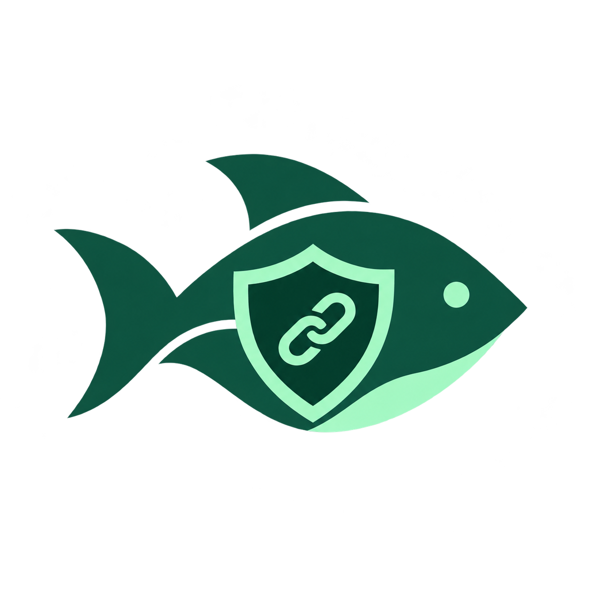

  
  <h1>LinkSentry</h1>
  
<strong>Pause before you click. Check the link.</strong>

  
A hobby project for checking useful website and domain signals before opening a link.

  

    
    
    
  

---

## What it does

LinkSentry checks a submitted URL and presents available threat, URL pattern, DNS, hosting, and page signals in one report. An optional isolated browser captures a view-only screenshot.

The score is a heuristic signal score, not a probability. A low-risk result does not guarantee a site is safe.

## Features

- Google Safe Browsing checks when configured.
- Optional VirusTotal lookups use existing reports; new URLs are not submitted.
- URL pattern checks and public A, AAAA, MX, and NS DNS records.
- IP registration and network context when available.
- Page title, metadata, and redirect details when available.
- Screenshot capture in an isolated Docker browser.
- Configurable scan rate limiting and short-lived result caching.

## Built with

Next.js, React, TypeScript, shadcn/ui, Python, FastAPI, Playwright, Docker Compose, and a Go proxy.

## Run locally on Windows

Requirements: Node.js/npm and Python. Docker Desktop is needed for screenshots. Run the web app and scanner in separate PowerShell windows from the project folder.

**Web app**

    if (-not (Test-Path .env)) { Copy-Item .env.example .env }
    npm.cmd install
    npm.cmd run dev

Open http://localhost:3000.

**Scanner API (second window)**

    Set-Location .\scanner
    py -m venv .venv
    .\.venv\Scripts\python.exe -m pip install -r requirements.txt
    if (-not (Test-Path .env)) { Copy-Item .env.example .env }
    .\.venv\Scripts\python.exe -m uvicorn main:app --reload --port 8000

Use scanner/.env.example for supported settings. Keep API keys only in local .env files.

**Optional screenshot service:** Start Docker Desktop, set the required private PREVIEW_SERVICE_TOKEN in .preview.env and the matching scanner setting, then run from the project root:

    docker compose --env-file .preview.env -f .\preview\compose.yaml up --build -d

Stop containers with:

    docker compose --env-file .preview.env -f .\preview\compose.yaml down

## Try it

Safe example: https://example.com
Google Safe Browsing test page: https://testsafebrowsing.appspot.com/s/phishing.html

The Google page is an intentional test. Do not enter information or proceed through browser warnings.

## Safety and privacy

Do not submit private, password-protected, or sensitive URLs. URLs can contain access tokens and may be sent to configured reputation/DNS services and the preview service. Do not use previews for pages requiring your credentials.

Threat feeds can miss new or targeted phishing pages. Review the evidence and do not rely on LinkSentry as your only security control. This is a hobby project, not a production-ready service.

## Project structure

- `src/app` - Next.js pages and styles
- `src/components` - Header, footer, and UI components
- `scanner` - FastAPI scanner
- `preview/proxy` - Go proxy
- `preview/renderer` - isolated Playwright service
- `public` - static assets and fish logo

## GitHub

Pushing source code to GitHub does not deploy it by itself. If connected to Vercel, a push may trigger a build or deployment based on Vercel settings. Never commit real .env files or credentials.
